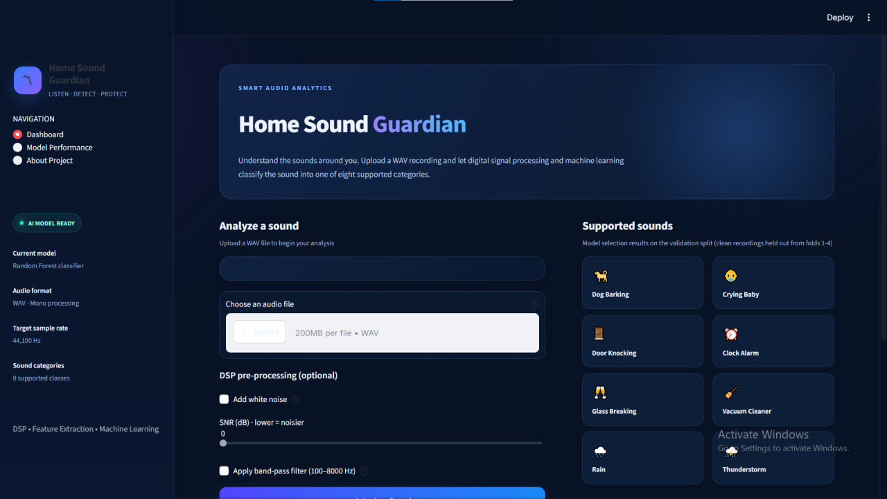
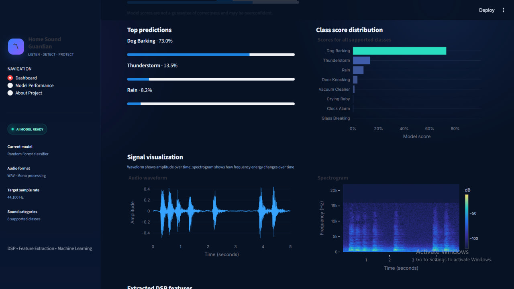
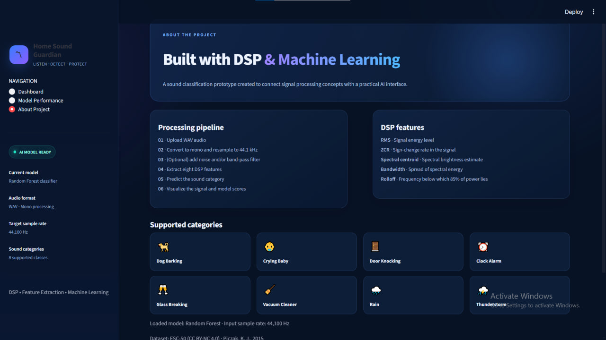

# 🏠 Home Sound Guardian
### Environmental Sound Classification Using Digital Signal Processing & Machine Learning

Home Sound Guardian is a machine learning project designed to recognize important environmental sounds that may occur inside or around a home. It combines **Digital Signal Processing (DSP)** techniques with **Machine Learning** to classify audio recordings into eight sound categories through an interactive Streamlit application.

The project also investigates how background noise and audio filtering affect classification performance.
## 📸 Application Preview

### Home Screen


### Sound Classification


### Model Evaluation


## 🎬 Demo Video
[](demo/home-sound-guardian-demo.mp4)

*Click the image to watch the project demo.*
## ✨ Features

- **8-Class Sound Classification:** Recognizes dog barking, crying babies, door knocking, clock alarms, glass breaking, vacuum cleaners, rain, and thunderstorms.
- **DSP Feature Extraction:** Extracts eight numerical features from audio signals.
- **Machine Learning:** Uses a Random Forest classifier trained with noise augmentation.
- **Interactive Interface:** Provides an audio upload interface using Streamlit.
- **Robustness Evaluation:** Tests the model under different noise levels and bandpass filtering.
- **Model Comparison:** Compares Random Forest performance against a Decision Tree baseline.

## 🔊 Supported Sound Categories

| Category | Description |
|---|---|
| Dog Barking | Dogs barking |
| Crying Baby | A baby crying |
| Door Knocking | Knocking on a wooden door |
| Clock Alarm | An alarm clock ringing |
| Glass Breaking | Glass breaking |
| Vacuum Cleaner | A vacuum cleaner operating |
| Rain | Rainfall |
| Thunderstorm | Thunderstorm sounds |

## 🛠️ Technologies Used

- Python
- Digital Signal Processing (DSP)
- NumPy and Pandas
- Librosa / SciPy
- Scikit-learn
- Joblib
- Streamlit
- Matplotlib

## ⚙️ Digital Signal Processing

The audio pipeline extracts eight features from each audio recording:

| Feature | Description |
|---|---|
| RMS | Measures signal energy |
| Zero-Crossing Rate (ZCR) | Measures how frequently the signal crosses zero |
| Spectral Centroid — Mean | Represents the average spectral center of mass |
| Spectral Centroid — Standard Deviation | Measures variation in spectral brightness |
| Spectral Bandwidth — Mean | Represents average spectral spread |
| Spectral Bandwidth — Standard Deviation | Measures variation in spectral spread |
| Spectral Rolloff — Mean | Represents an upper-frequency boundary containing most spectral energy |
| Spectral Rolloff — Standard Deviation | Measures variation in spectral rolloff |

These features convert audio signals into numerical representations suitable for machine learning.

## 🤖 Machine Learning Model

The project uses a **Random Forest classifier** to predict the environmental sound category from the extracted DSP features.

The selected dataset subset contains 320 recordings across eight classes, with 40 recordings per class.

The evaluation uses 64 recordings from ESC-50 fold 5 as the test set. The model is also compared with a Decision Tree baseline.

## 📊 Evaluation Results

The following results were obtained on the 64-recording test set.

| Evaluation Condition | Random Forest Accuracy | Random Forest Macro F1 |
|---|---:|---:|
| Clean Audio | 57.8% | 0.573 |
| White Noise — 20 dB | 67.2% | 0.662 |
| White Noise — 10 dB | 65.6% | 0.653 |
| White Noise — 0 dB | 14.1% | 0.061 |
| Bandpass-Filtered Audio | 60.9% | 0.581 |

### Random Forest vs. Decision Tree

| Evaluation Condition | Random Forest | Decision Tree |
|---|---:|---:|
| Clean Audio | 57.8% | 48.4% |
| White Noise — 20 dB | 67.2% | 26.6% |
| White Noise — 10 dB | 65.6% | 20.3% |
| White Noise — 0 dB | 14.1% | 17.2% |
| Bandpass-Filtered Audio | 60.9% | 48.4% |

The Random Forest model outperformed the Decision Tree baseline in most tested conditions. However, performance dropped substantially under very strong noise, demonstrating that severe background noise remains a challenge.

**Important:** These results are based on a small test set and should be interpreted as preliminary experimental findings, not a guarantee of real-world performance.

## 🖥️ Application

The Streamlit interface allows users to upload an audio recording and obtain a predicted sound category.

The application uses the saved model bundle and extracts the same eight features required during training.

## 📁 Project Structure

```text
home-sound-guardian/
├── app.py
├── models/
│   ├── best_sound_guardian_model.joblib
│   └── sound_guardian_model.joblib
├── scripts/
│   ├── dsp_robustness.py
│   ├── explore_audio.py
│   ├── extract_features.py
│   ├── prepare_dataset.py
├── demo/
│   └── home-sound-guardian-demo.mp4│   └── train_model.py
├── results/
│   ├── model_comparison.png
│   ├── model_comparison_report.txt
│   └── per_class_metrics.csv
├── data/                 # Local dataset; not included in Git
├── اصوات/                # Local audio files; not included in Git
├── .gitignore
└── README.md
```

## 🚀 Getting Started

### 1. Clone the Repository

```bash
git clone https://github.com/GANNAAMR66/home-sound-guardian.git
cd home-sound-guardian
```

### 2. Create a Virtual Environment

```bash
python -m venv .venv
```

Activate it on Windows:

```powershell
.venv\Scripts\Activate.ps1
```

### 3. Install Dependencies

Install the packages required by the project:

```bash
pip install numpy pandas scipy scikit-learn joblib streamlit matplotlib librosa soundfile
```

If the project includes a `requirements.txt`, you can install dependencies using:

```bash
pip install -r requirements.txt
```

### 4. Run the Application

```bash
streamlit run app.py
```

The application should open in your browser.

## 📂 Dataset

This project uses a selected subset of the **ESC-50 environmental sound dataset**, consisting of eight classes and 320 recordings.

The dataset is not included in this repository. Obtain it from the official source and place it in the expected local directory before running scripts that require the original audio files.

Dataset: [ESC-50 — GitHub](https://github.com/karolpiczak/ESC-50)

Please review the dataset's license and attribution requirements before redistributing any dataset material.

## ⚠️ Limitations

- The evaluation test set contains only 64 recordings.
- Results may vary with different train/test splits and noise configurations.
- Strong noise significantly reduces classification accuracy.
- White-noise tests do not represent every real-world acoustic environment.
- The classifier is limited to the eight trained sound categories.
- A prediction should not be treated as a guaranteed safety alert or emergency detection.

## 🔮 Future Improvements

- Expand the dataset and evaluate more sound categories.
- Test on recordings from real home environments.
- Explore MFCCs and other audio representations.
- Evaluate additional machine learning and deep learning models.
- Improve confidence reporting and unknown-sound handling.
- Deploy the application as an accessible web service.

## 👩‍💻 Author

**Ganna Amr**

Artificial Intelligence Student | Kafrelsheikh University

- **GitHub:** [GANNAAMR66](https://github.com/GANNAAMR66)
- **Portfolio:** [gannaamr66.github.io](https://gannaamr66.github.io/)

---

*Home Sound Guardian — Exploring how DSP and Machine Learning can help computers understand everyday environmental sounds.*